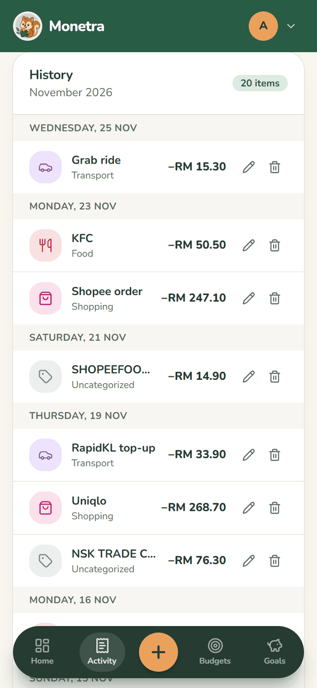
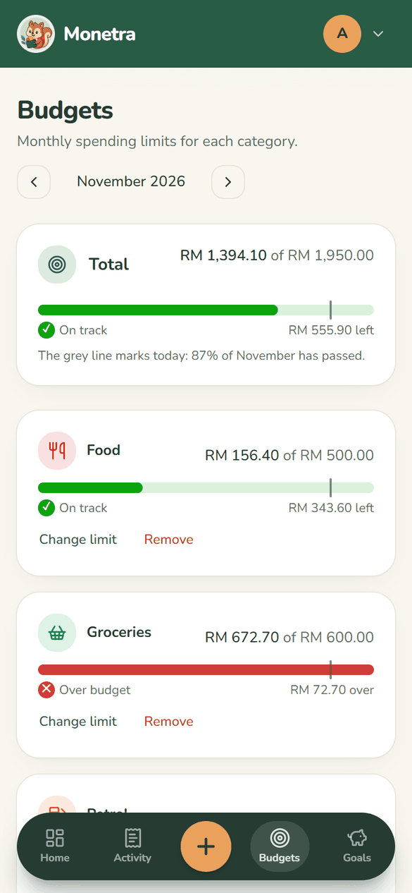
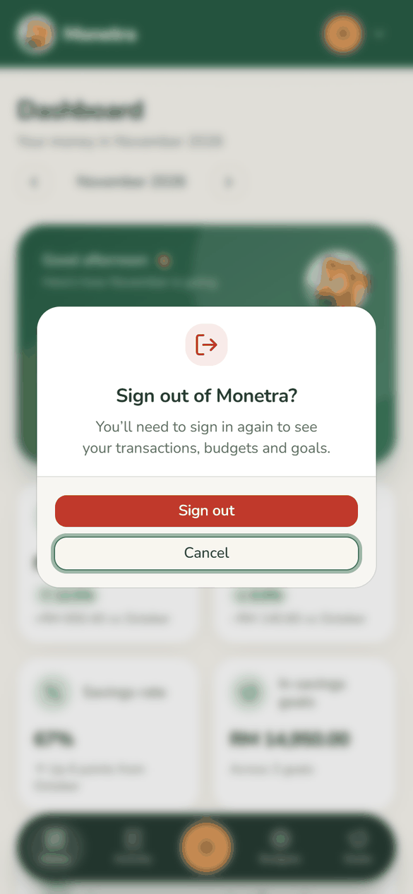
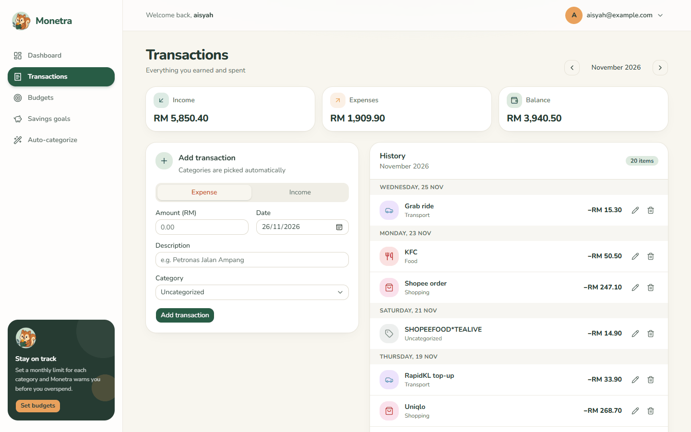
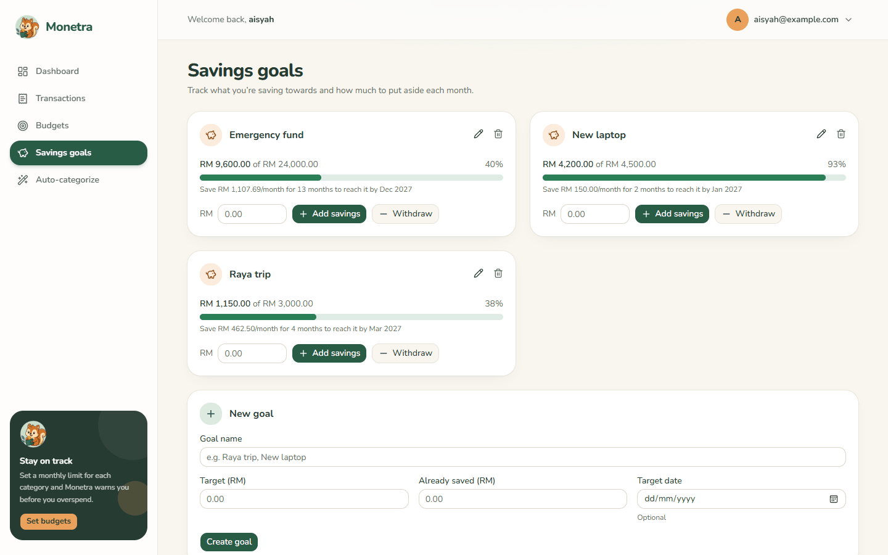
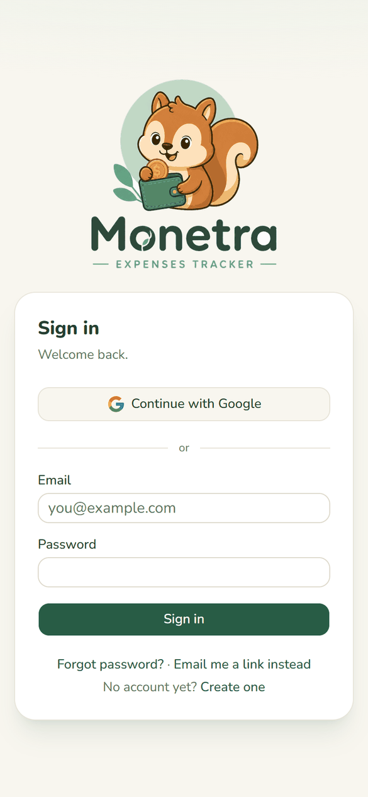

<p align="center">
  
</p>

<p align="center">
  A personal expense tracker for Malaysia: log what you earn and spend in RM, set monthly budgets,
  save towards goals, and let keyword rules categorize transactions for you.
</p>

<p align="center">
  
</p>

## Screenshots

Monetra works on desktop and phone. On a phone it can be added to the Home Screen and opens full screen like an app.

| Dashboard | Transactions | Budgets | Sign-out confirmation |
| :---: | :---: | :---: | :---: |
|  |  |  |  |

| Transactions (desktop) | Savings goals (desktop) |
| :---: | :---: |
|  |  |

<details>
<summary>Sign-in page</summary>
<br />

</details>

<sub>Screenshots use made-up sample data.</sub>

## Features

- **Dashboard**: the month's balance and savings rate, income and expenses with change vs last month, a 6-month cashflow chart, spending by category, daily spending, recent transactions, budgets and goals at a glance
- **Transactions**: add, edit and delete income and expenses, grouped by day, each with its category's icon
- **Auto-categorization**: keyword rules (e.g. `PETRONAS` → Petrol, `GRABFOOD` → Food) pick the category as you type. Rules match whole words, can take priority over others, and can be applied to past uncategorized transactions in one go. New accounts start with rules for common Malaysian merchants
- **Budgets**: a monthly limit per category with a progress bar, a "today" marker showing how far through the month you are, on-track / close / over status, and one-click copy from last month
- **Savings goals**: target, deadline and progress, with how much to save each month to get there. Suggests an emergency fund of 3–6 months of your average spending
- **Sign-in**: email and password, a magic link by email, or Google, plus password reset
- **Installable**: add it to the Home Screen on iPhone or Android to run full screen
- **Safe by default**: confirmation pop-ups before signing out or deleting anything, and every user can only ever read and write their own data (Postgres row-level security)
- **Accessible charts**: the colours were checked for colour-blind readers, every chart has a "Show as table" view, and status is always shown with an icon and words, not colour alone

## Tech stack

| Area | Tools |
| --- | --- |
| Frontend | [React 19](https://react.dev), TypeScript, [Vite](https://vite.dev), React Router |
| UI | [Tailwind CSS v4](https://tailwindcss.com), [shadcn/ui](https://ui.shadcn.com) (Radix), [Lucide](https://lucide.dev) icons, Nunito font |
| Charts | [Recharts](https://recharts.org), date-fns |
| Backend | [Supabase](https://supabase.com): Postgres, Auth and row-level security |
| Hosting | [Vercel](https://vercel.com), plus a GitHub Actions job that keeps the free Supabase project awake |

## Getting started

### 1. Requirements

- Node.js **20.19+** or **22.12+**
- A free [Supabase](https://supabase.com) project

### 2. Set up the database

In the Supabase dashboard, open **SQL Editor → New query**, paste in [`supabase/schema.sql`](supabase/schema.sql) and click **Run**. This creates:

- the tables (`categories`, `transactions`, `category_rules`, `budgets`, `savings_goals`)
- row-level security, so each user only sees their own rows
- a trigger that gives every new user default categories and merchant rules

### 3. Configure and run

```bash
git clone https://github.com/suhailazmin/Finance-Tracker-Web-App.git
cd Finance-Tracker-Web-App
npm install
cp .env.example .env.local
```

Fill in `.env.local` from **Supabase → Project Settings → API**:

```bash
VITE_SUPABASE_URL=https://your-project-id.supabase.co
VITE_SUPABASE_ANON_KEY=your-publishable-key   # the publishable/anon key — never the service_role key
```

Then start the app:

```bash
npm run dev
```

Open http://localhost:5173 and create an account.

> **Sign-in links and Google:** in Supabase go to **Authentication → URL Configuration** and add `http://localhost:5173` (and later your deployed URL) to **Redirect URLs**. To use Google sign-in, enable it under **Authentication → Providers**.

### Scripts

| Command | What it does |
| --- | --- |
| `npm run dev` | Start the dev server with hot reload |
| `npm run build` | Type-check and build for production into `dist/` |
| `npm run preview` | Serve the production build locally |
| `npm run lint` | Lint with Oxlint |

## Deploying

1. Import the repo into [Vercel](https://vercel.com). The Vite preset works as-is.
2. Add `VITE_SUPABASE_URL` and `VITE_SUPABASE_ANON_KEY` as environment variables.
3. Add the deployed URL to Supabase's **Redirect URLs**.

[`vercel.json`](vercel.json) sends every path to `index.html`, so routes like `/budgets` still work when you refresh the page.

### Keeping the free Supabase project awake

Supabase pauses free projects after about a week without activity. The workflow in [`.github/workflows/keep-supabase-awake.yml`](.github/workflows/keep-supabase-awake.yml) runs a tiny read-only query every Monday and Thursday so that doesn't happen. It needs two repository secrets, **Settings → Secrets and variables → Actions**: `VITE_SUPABASE_URL` and `VITE_SUPABASE_ANON_KEY`. If a run fails, GitHub emails you, which usually means the project was paused. Restore it from the Supabase dashboard.

## Project structure

```text
src/
├── pages/           Dashboard, Transactions, Budgets, Goals, Rules, Account, Login
├── components/      Layout (sidebar + phone tab bar), cards, forms, ConfirmDialog
│   ├── charts/      Cashflow, daily spending and category breakdown
│   └── ui/          shadcn/ui components
├── hooks/           Data hooks (useTransactions, useBudgets, useSavingsGoals, …)
├── lib/             Supabase client, formatting, budget/goal maths, categorization rules
├── auth/            Session context and the route guard
└── assets/          Monetra logos
supabase/schema.sql  Database tables, security policies and new-user defaults
public/              Favicon, app icons and the web app manifest
```
