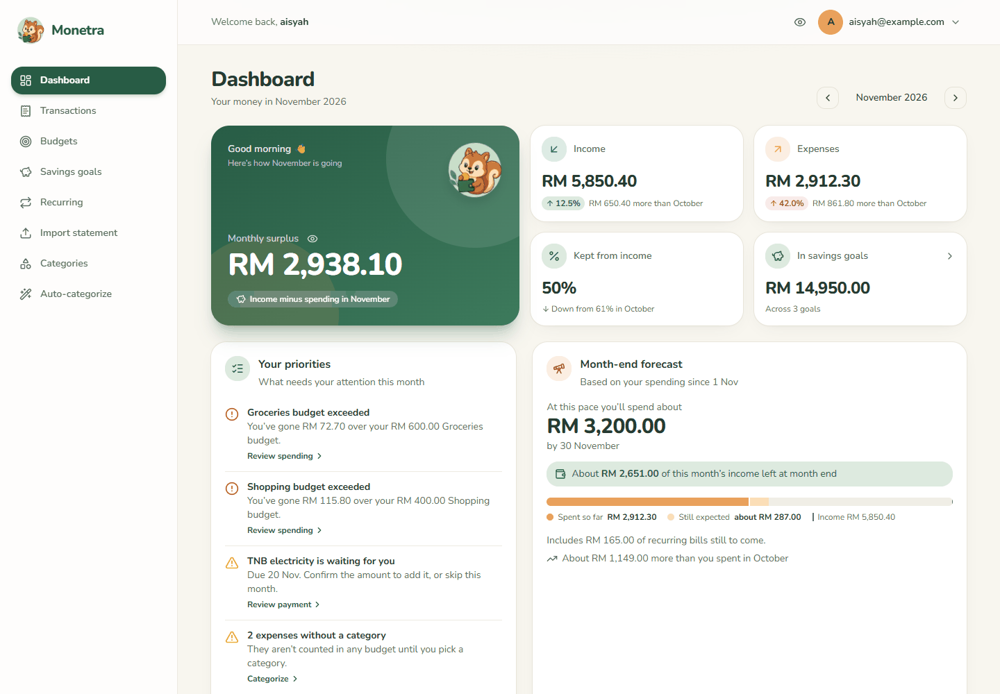
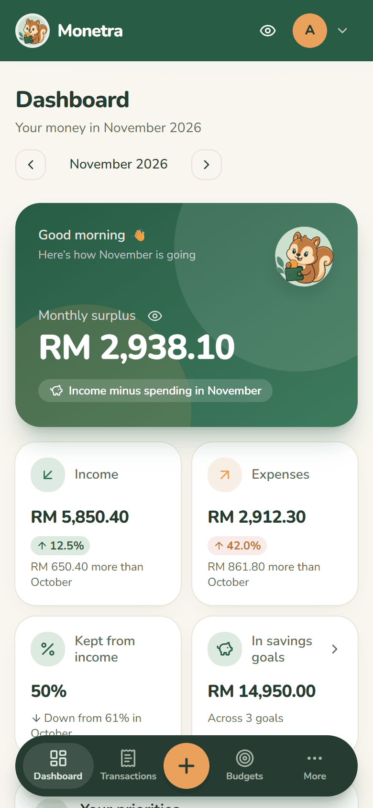
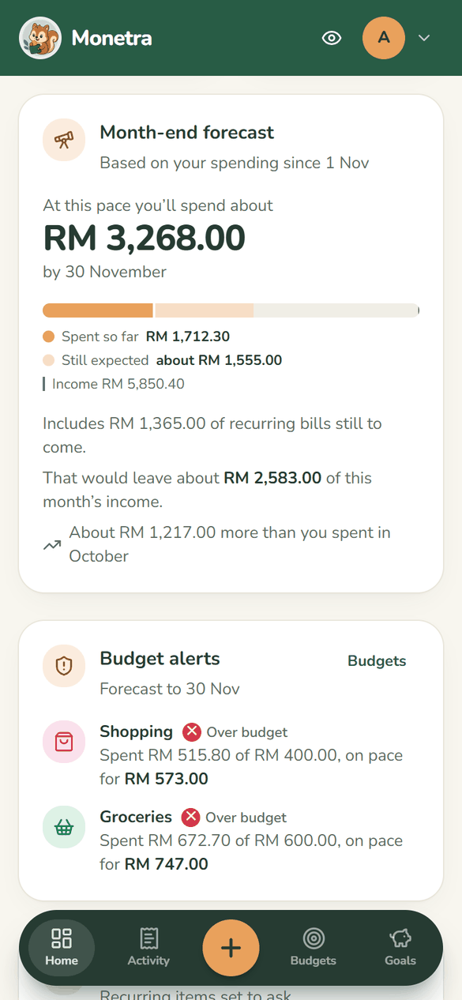
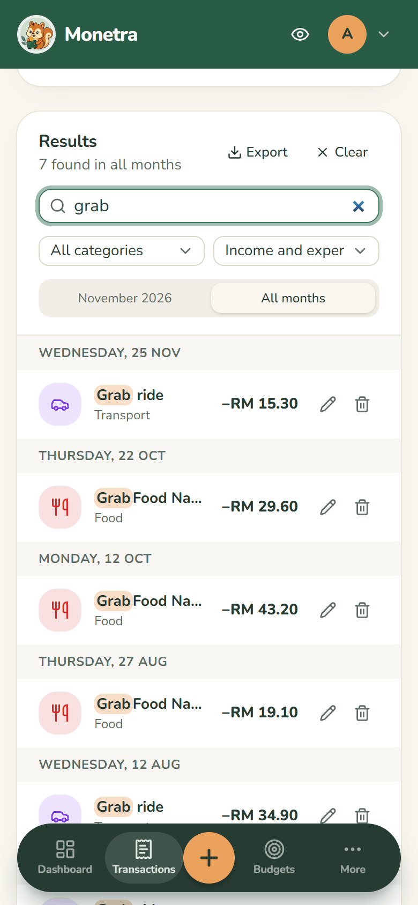
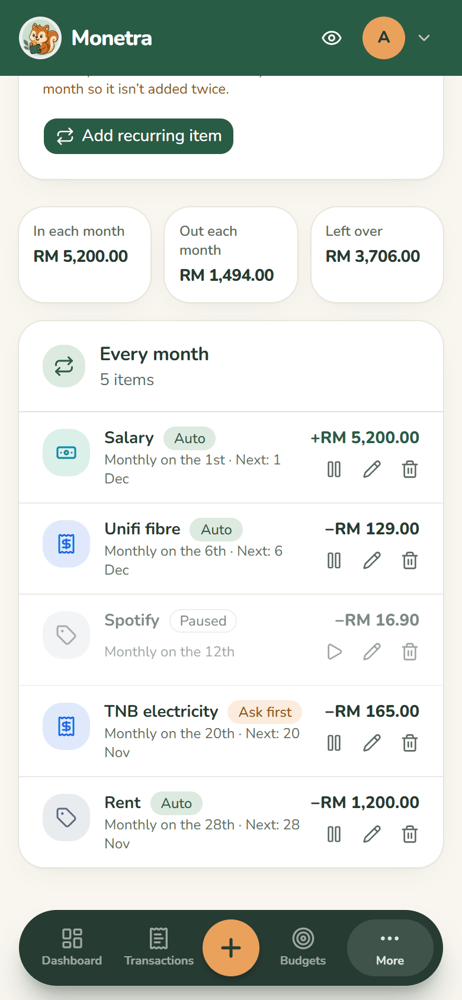
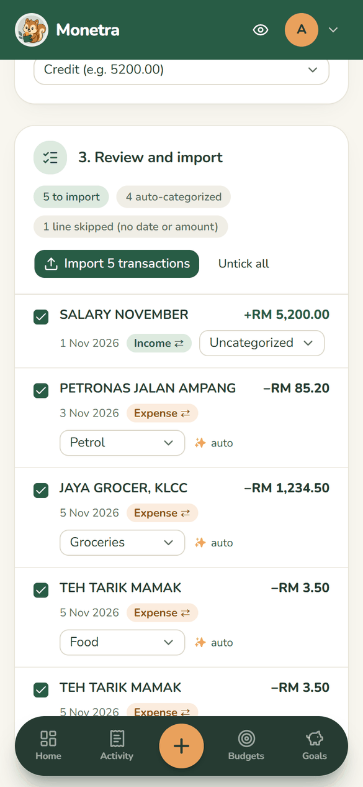
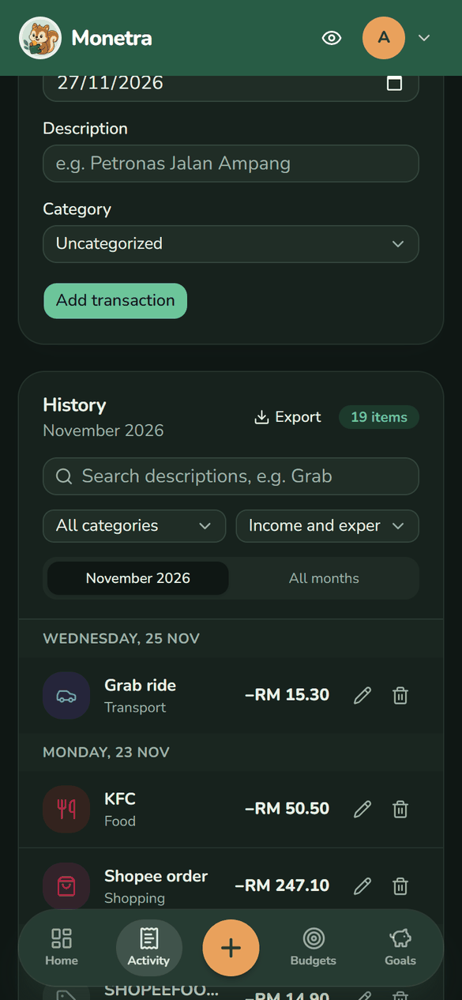
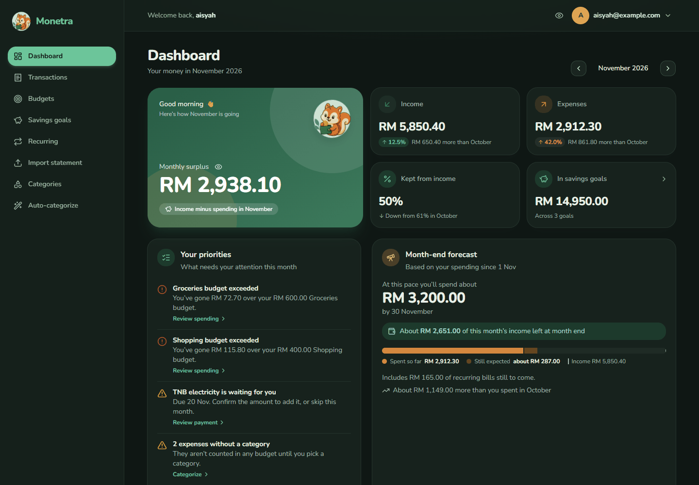
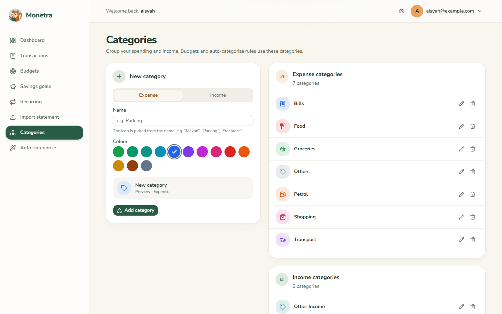

<p align="center">
  
</p>

<p align="center">
  A personal expense tracker for Malaysia: log what you earn and spend in RM, import bank statements,
  set budgets, save towards goals, and see where the month is heading before it ends.
</p>

<p align="center">
  <a href="https://finance-tracker-web-app-2msr.vercel.app/"><strong>Live demo →</strong></a>
  <br />
  <sub>Create a free account to try it. Your data is private to your account.</sub>
</p>

<p align="center">
  
</p>

## Screenshots

Monetra works on desktop and phone. On a phone it installs to the Home Screen, opens full screen and keeps working offline.

| Dashboard | Month-end forecast | Search | Recurring |
| :---: | :---: | :---: | :---: |
|  |  |  |  |

| Statement import | Dark mode | Sign-in |
| :---: | :---: | :---: |
|  |  |  |

<details>
<summary>More: dark mode on desktop, and the Categories page</summary>
<br />

<br /><br />

</details>

<sub>Screenshots use made-up sample data.</sub>

## Features

### Tracking
- **Dashboard**: the monthly surplus (income minus spending, or the shortfall when spending is higher), income and expenses compared with last month, how much of your income you kept, **your priorities**, the month-end forecast, recent transactions and spending by category (tap a category to see its transactions). The 6-month trend, daily spending and goals are one tap away under **More insights**
- **Transactions**: add, edit and delete income and expenses, grouped by day with category icons. Tap one for its **details**: full description, amount, date, category, type, where it came from (added by you, imported, recurring) and when it was added, with a link to everything from the same merchant
- **Search**: by merchant or by **exact amount** (`12.50` or `RM 12.50`), across every month, this month or **a date range**, combined with category and expense/income filters. Export saves exactly what's found
- **Import bank statements (CSV)**: works with Maybank, CIMB, Touch ’n Go eWallet and other exports. Monetra finds the columns and reads Malaysian dates and amounts (`1,234.50`, `12.00-`, `CR`/`DR`). Before saving you see:
  - a summary: how many will be imported (money in and out), how many are already in Monetra, possible duplicates and lines that couldn't be read
  - **possible duplicates**: lines with the same date and amount as a transaction you already have (typed in, or from another file), left out unless you tick them
  - **why each line was skipped** ("“31/02/2026” isn't a date"), with a **Fix** button to type in what's missing
  - a filter and **one category for many rows at once** (type `SHOPEE`, pick Shopping)

  Afterwards a **reconciliation** shows every line accounted for: imported, duplicates skipped, left out and unreadable, with the income and expenses imported. **Past imports** lists each statement, and a whole import can be removed (with Undo). Importing the same file twice never creates duplicates
- **Recurring transactions**: salary, rent and bills are added every month automatically, or shown on the dashboard to confirm when the amount changes (like TNB). Missed months are caught up, and nothing is ever added twice
- **Export to CSV**: download all your data, or exactly what's on screen, for a backup or a spreadsheet. Monetra can import its own export back

### Planning
- **Your priorities**: a short list of what needs doing this month, most urgent first, each with one next step: a budget that's over or heading over, spending that may pass your income, a bill waiting to be confirmed, expenses without a category, a goal that's falling behind, and how much you can safely save
- **Month-end forecast**: "at this pace you'll spend about RM X this month" and how much of your income should be left. It says which days it's based on, keeps everyday spending and recurring bills apart (naming the bills still to come), warns when there's under a week of data, points out a big one-off purchase that's pushing it up (and what it would be without it), and explains how it's worked out
- **Budgets**: a monthly limit per category with a "today" marker, an estimate for the month end, and **alerts before you go over**
- **Savings goals**: target, deadline and progress, with how much to save each month. Suggests an emergency fund of 3–6 months of your average spending
- **Categories and auto-categorization**: create, rename and recolour categories, and an icon is picked from the name. Keyword rules (e.g. `PETRONAS` → Petrol) categorize new and imported transactions, and new accounts start with rules for common Malaysian merchants

### On your phone
- **Installable**: add it to the Home Screen and it opens full screen with a splash screen and a floating tab bar. Every page is reachable from the tab bar, under **More**
- **Offline**: opens instantly with no signal and shows your last-loaded data. Transactions you add offline are saved on the phone and sync when you're back online
- **Pull to refresh**, and pages that load quickly, because each page downloads only when it's opened

### Comfort and privacy
- **Dark mode**: Light, Dark or System (follows your phone)
- **Hide amounts**: one tap turns every RM figure into `RM ••••` for using the app in public
- **Undo** instead of "Are you sure?" for deletes: the message names what was deleted ("Deleted “Uniqlo” · −RM 268.70 · Shopping · 19 Nov 2026") and stays for 10 seconds. Signing out and deleting a category still ask first
- **Private by design**: Postgres row-level security means every user can only read and write their own data. The copy kept for offline use is deleted when you sign out
- **Accessible charts**: chart colours are checked for colour-blind readers in both light and dark mode, every chart has a "Show as table" view, and status is always shown with an icon and words

## Tech stack

| Area | Tools |
| --- | --- |
| Frontend | [React 19](https://react.dev), TypeScript, [Vite](https://vite.dev), React Router |
| UI | [Tailwind CSS v4](https://tailwindcss.com), [shadcn/ui](https://ui.shadcn.com) (Radix), [Lucide](https://lucide.dev) icons, [Sonner](https://sonner.emilkowal.ski) toasts, Nunito font |
| Charts and data | [Recharts](https://recharts.org), date-fns, [Papa Parse](https://www.papaparse.com) for CSV |
| Offline | [vite-plugin-pwa](https://vite-pwa-org.netlify.app) (Workbox service worker) |
| Testing | [Vitest](https://vitest.dev) |
| Backend | [Supabase](https://supabase.com): Postgres, Auth and row-level security |
| Hosting | [Vercel](https://vercel.com), plus a GitHub Actions job that keeps the free Supabase project awake |

## Getting started

### 1. Requirements

- Node.js **20.19+** or **22.12+**
- A free [Supabase](https://supabase.com) project

### 2. Set up the database

In the Supabase dashboard, open **SQL Editor → New query**, paste in [`supabase/schema.sql`](supabase/schema.sql) and click **Run**. This creates:

- the tables (`categories`, `transactions`, `category_rules`, `budgets`, `savings_goals`, `recurring_transactions`)
- row-level security, so each user only sees their own rows
- a trigger that gives every new user default categories and merchant rules

> **Already set up from an older version?** Run [`supabase/migrations/20261127_recurring_transactions.sql`](supabase/migrations/20261127_recurring_transactions.sql) once to add recurring transactions. Until then, the Recurring page shows these steps and the rest of the app works as normal.

### 3. Configure and run

```bash
git clone https://github.com/suhailazmin/Finance-Tracker-Web-App.git
cd Finance-Tracker-Web-App
npm install
cp .env.example .env.local
```

Fill in `.env.local` from **Supabase → Project Settings → API**:

```bash
VITE_SUPABASE_URL=https://your-project-id.supabase.co
VITE_SUPABASE_ANON_KEY=your-publishable-key   # the publishable/anon key — never the service_role key
```

Then start the app:

```bash
npm run dev
```

Open http://localhost:5173 and create an account.

> **Sign-in links and Google:** in Supabase go to **Authentication → URL Configuration** and add `http://localhost:5173` (and later your deployed URL) to **Redirect URLs**. To use Google sign-in, enable it under **Authentication → Providers**.

### Scripts

| Command | What it does |
| --- | --- |
| `npm run dev` | Start the dev server with hot reload (the offline service worker is off here) |
| `npm run build` | Type-check and build for production into `dist/`, including the service worker |
| `npm run preview` | Serve the production build locally. Use this to try offline mode |
| `npm run lint` | Lint with Oxlint |
| `npm test` | Run the tests for the money maths: budgets, goal plans, auto-categorize rules and forecasts (`npm run test:watch` reruns them as you edit) |

Every pull request runs the tests, lint and a production build on GitHub Actions ([`.github/workflows/ci.yml`](.github/workflows/ci.yml)).

## Deploying

1. Import the repo into [Vercel](https://vercel.com). The Vite preset works as-is.
2. Add `VITE_SUPABASE_URL` and `VITE_SUPABASE_ANON_KEY` as environment variables.
3. Add the deployed URL to Supabase's **Redirect URLs**.

[`vercel.json`](vercel.json) sends every path to `index.html`, so routes like `/budgets` still work when you refresh the page. When a new version is deployed, open copies of the app show a **Reload** prompt instead of refreshing mid-task.

### Keeping the free Supabase project awake

Supabase pauses free projects after about a week without activity. The workflow in [`.github/workflows/keep-supabase-awake.yml`](.github/workflows/keep-supabase-awake.yml) runs a tiny read-only query every Monday and Thursday so that doesn't happen. It needs two repository secrets, **Settings → Secrets and variables → Actions**: `VITE_SUPABASE_URL` and `VITE_SUPABASE_ANON_KEY`. If a run fails, GitHub emails you, which usually means the project was paused. Restore it from the Supabase dashboard.

## Project structure

```text
src/
├── pages/           Dashboard, Transactions, Import, Recurring, Budgets, Goals, Categories, Rules, Account, Login
│                    (each loads on demand)
├── components/      Layout (sidebar + phone tab bar), cards, forms, forecast, pull-to-refresh, dialogs
│   ├── charts/      Cashflow, daily spending and category breakdown
│   └── ui/          shadcn/ui components
├── hooks/           Data hooks (useTransactions, useTransactionSearch, useRecurring, useBudgets, …)
├── lib/             Supabase client and money logic: forecast, recurring dates, CSV import/export,
│                    categorization rules, offline outbox, theme, hide-amounts, undo
├── auth/            Session context and the route guard
└── assets/          Monetra logos
supabase/
├── schema.sql       Database tables, security policies and new-user defaults
└── migrations/      Changes for databases created from an older schema
public/              Favicon, app icons and the web app manifest
```
